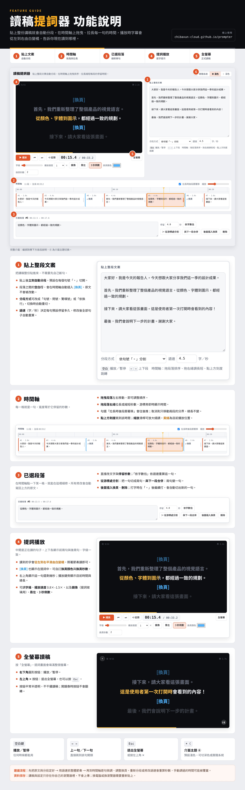

# 讀稿提詞器 Teleprompter

> 貼上講稿就能用的網頁提詞器：自動分段、時間軸拖曳調整、逐字提示讀到哪裡。
> A free, browser-based teleprompter for Chinese scripts — paste your script, adjust timing on a drag-and-drop timeline, and read along as each line highlights word by word.

**▶ 線上使用 Try it：** https://chibaxun-cloud.github.io/prompter/

不用安裝、不用註冊，打開網頁就能用。講稿只存在你自己的瀏覽器裡，不會上傳。

## 主要功能

- **自動分段**：貼上整份講稿，依句號「。」自動切成一句一句；段落間的空白行會自動插入「[換頁]」。
- **時間軸拖曳**：拖曳調整順序，拖右緣拉長或縮短每句停留的秒數。
- **逐字提示**：播放時目前這句從左到右由白變橘，上下顯示前後兩句。
- **讀稿輔助**：語速設定、播放速度 0.8×–1.5×、鏡像（提詞玻璃）、3 秒倒數、全螢幕。
- **快捷鍵**：空白鍵播放／暫停，← → 切換上下句，Esc 退出全螢幕。

## 功能說明

## Features (English)

- Auto-splits pasted scripts into sentences at Chinese full stops; blank lines become page-turn markers.
- Drag-and-drop timeline to reorder lines and resize how long each one stays on screen.
- Karaoke-style highlight sweeps across the current line; previous and next two lines stay visible.
- Mirror mode for teleprompter glass, playback speed control, countdown, fullscreen with on-screen controls.
- Single HTML file, no build step, no server. Data stays in your browser's local storage.
